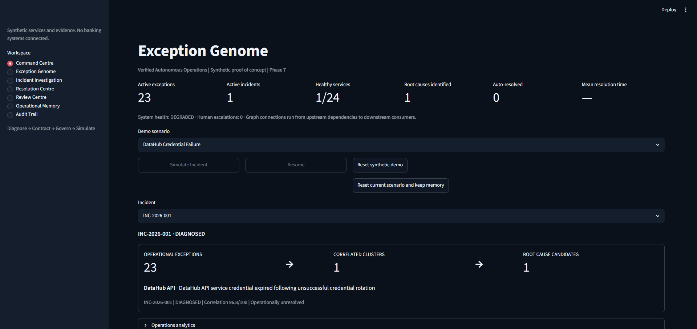
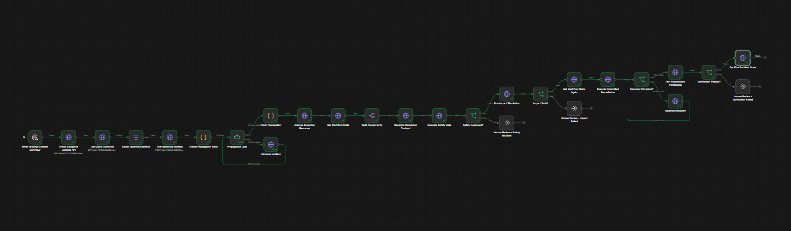
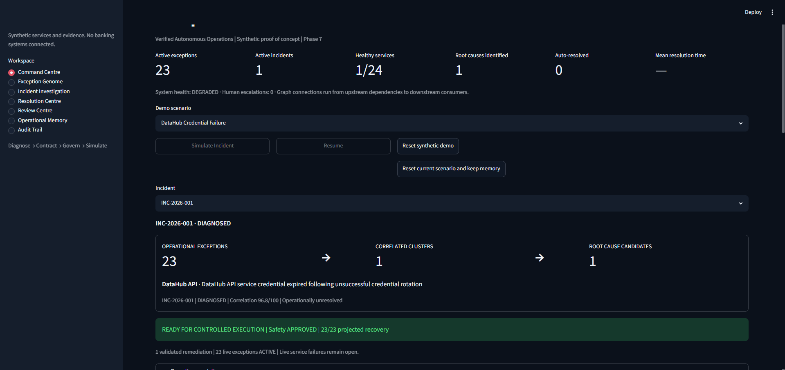
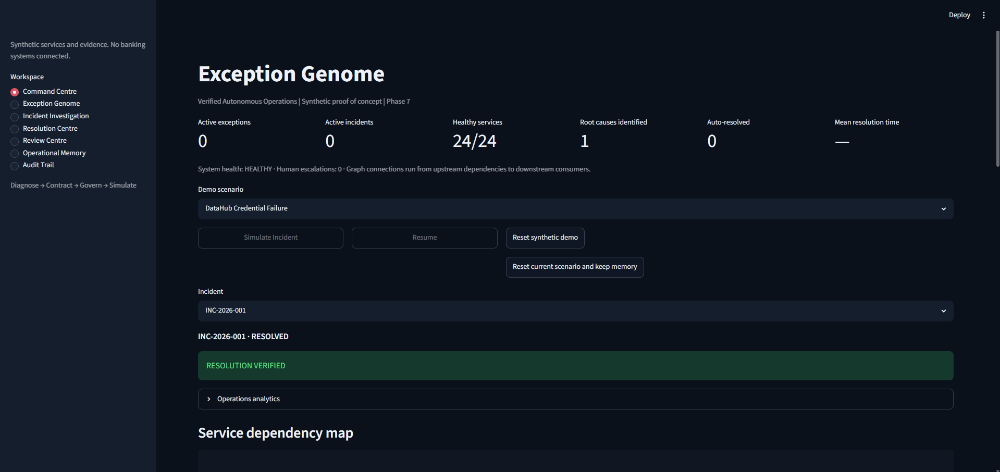
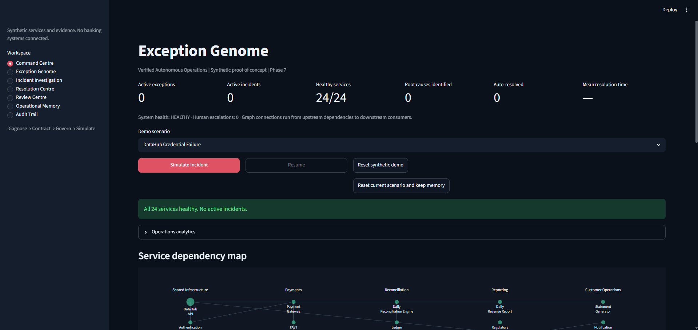

# Exception Genome

### Verified Autonomous Operations

**Exception Genome** is a governed autonomous operational exception-resolution prototype built for the **OCBC IGNITE Innovation Challenge 2026 — Intelligent Operations: From Automation to Autonomous Resolution**.

Instead of treating every operational exception as an isolated ticket, Exception Genome investigates whether multiple failures are actually symptoms of the same upstream problem.

## 23 Exceptions → 1 Root Cause → 1 Verified Remediation

In the flagship scenario, a single DataHub credential failure causes **23 downstream operational exceptions** across reporting, reconciliation, settlements and customer operations.

Exception Genome:

1. Detects the operational exceptions
2. Builds an Exception Genome for each failure
3. Correlates related exceptions
4. Identifies the most likely shared root cause
5. Generates a Resolution Contract
6. Applies a deterministic Safety Gate
7. Tests the remediation in an Impact Sandbox
8. Executes an approved simulated remediation
9. Monitors service recovery
10. Independently verifies the final state
11. Stores verified outcomes in Operational Memory

> **Do not automate 23 tickets. Remove the reason the 23 tickets exist.**

---

## Demo



The flagship scenario demonstrates:

```text
23 operational exceptions
        ↓
1 correlated cluster
        ↓
DataHub API identified as shared root cause
        ↓
Resolution Contract
        ↓
Deterministic Safety Gate
        ↓
Impact Sandbox
        ↓
Controlled remediation
        ↓
Progressive service recovery
        ↓
Independent verification
        ↓
Incident resolved
```

---

## Core Principle

Exception Genome separates **intelligence from authority**.

The reasoning layer may:

- interpret evidence
- correlate failures
- identify likely root causes
- compare alternative hypotheses
- recommend remediation
- explain its reasoning

It does **not** independently control:

- safety approval
- execution permission
- simulation outcome
- final verification
- incident closure

Those decisions remain governed by deterministic rules.

---

## System Architecture

```text
Streamlit Command Centre
        │
        ▼
Python Domain Services
        │
        ├── Exception Genome Engine
        ├── Correlation Engine
        ├── Root Cause Analysis
        ├── Resolution Contract
        ├── Safety Gate
        ├── Impact Simulator
        ├── Execution Engine
        ├── Verification Engine
        ├── Operational Memory
        └── Prevention Engine
        │
        ▼
FastAPI
        │
        ▼
n8n Orchestration
```

### Technology Stack

- **Python**
- **Streamlit**
- **FastAPI**
- **SQLite**
- **NetworkX**
- **Plotly**
- **n8n**
- **Pytest**

---

## Orchestration Workflow



n8n coordinates the resolution lifecycle, but it does **not** decide whether an action is safe.

The backend remains the source of truth for:

- current workflow state
- authority
- safety decisions
- execution readiness
- verification status

---

## Resolution Contract

Before any remediation can execute, Exception Genome freezes the operational decision into a structured **Resolution Contract** containing:

- root-cause diagnosis
- supporting evidence
- proposed action
- target
- scope
- expected outcome
- rollback information
- authority requirements

The contract is protected by a SHA-256 hash.

If safety-relevant information changes, previous approvals become stale and must be recalculated.

---

## Safety Gate



The Safety Gate uses deterministic rules rather than allowing the reasoning layer to grant itself authority.

Checks include:

- approved action type
- target alignment
- evidence completeness
- action scope
- rollback availability
- contract integrity
- duplicate execution
- current operational state

Unsafe or higher-risk cases are routed to **Human Review**.

---

## Independent Verification



A successful action does **not** automatically mean the incident is resolved.

After remediation, Exception Genome independently checks whether expected service and operational states have actually recovered.

```text
Execution succeeded
        ≠
Incident resolved
```

The incident closes only after verification succeeds.

If verification fails, the workflow can:

- reopen the incident
- perform rollback
- escalate to human review

---

## Supported Scenarios

The prototype is not limited to the flagship 23-exception scenario.

It also supports:

### Shared Root Cause
Multiple operational exceptions originate from one upstream failure.

### Isolated Failure
A single service fails without sufficient evidence of a wider incident.

### Multiple Concurrent Root Causes
Separate exception clusters are assigned and resolved independently.

### Ambiguous Evidence
The system refuses to force a diagnosis when confidence is insufficient and can request additional evidence.

### Human Review
Higher-risk or inconclusive cases require reviewer authority before execution.

### Verification Failure
A remediation may execute successfully while the expected operational outcome remains incorrect.

### Recurrence and Prevention
Verified incident history is stored in Operational Memory. Repeated patterns can generate preventive recommendations.

---

## Operational Memory

Resolved incidents can be stored as verified historical patterns containing:

- previous root cause
- previous remediation
- evidence
- similarity information
- outcome
- success or failure history

Historical similarity can assist future investigations, but past success does **not** bypass current safety controls.

---

## Command Centre



The Streamlit Command Centre provides visibility into:

- service health
- operational exceptions
- dependency relationships
- incident state
- root-cause evidence
- Resolution Contracts
- Safety Gate decisions
- execution progress
- verification
- human review
- audit history
- Operational Memory

---

## Running Locally

### 1. Install dependencies

```bash
pip install -r requirements.txt
```

### 2. Start Streamlit

```bash
python -m streamlit run app.py
```

### 3. Start the FastAPI backend

```bash
python -m uvicorn api.main:app --host 127.0.0.1 --port 8000
```

FastAPI documentation is available locally at:

```text
http://127.0.0.1:8000/docs
```

### 4. Start n8n

```bash
npx n8n
```

Import the Exception Genome n8n workflow and connect it to:

```text
http://127.0.0.1:8000
```

---

## Testing

The completed prototype passed:

```text
57 / 57 core unit tests
6 / 6 targeted FastAPI tests
```

Testing covers areas including:

- correlation
- diagnosis
- safety
- impact simulation
- execution
- idempotency
- recovery
- verification
- rollback
- evidence updates
- multiple assignments
- Operational Memory

---

## Documentation

Additional technical documentation is available in:

```text
docs/
├── API_CONTRACT.md
├── N8N_HANDOFF.md
├── Phase_4_Report.md
├── Phase_5_Report.md
├── Phase_6_Report.md
└── Phase_7_Report.md
```

---

## Prototype Scope

This project is a **synthetic proof-of-concept**.

It demonstrates an architecture for governed autonomous operational exception resolution.

It does **not** claim:

- access to OCBC systems
- access to OCBC customer data
- connection to live banking infrastructure
- production readiness
- real autonomous banking actions
- replication of OCBC's internal architecture

All banking services, incidents, events and operational data used in the prototype are synthetic.

---

## Why Synthetic Data?

Real OCBC infrastructure and customer data are intentionally outside the challenge scope.

The synthetic environment was designed to model structural properties relevant to operational incidents, including:

- service dependencies
- timestamps
- error families
- cascading failures
- recent changes
- isolated failures
- multiple simultaneous root causes
- incomplete evidence
- remediation and recovery states

The goal is to validate the **decision and governance architecture**, not reproduce OCBC's production environment.

---

## Future Production Direction

A real implementation would require integration with existing enterprise systems such as:

- observability and monitoring
- service catalogues / CMDB
- ITSM
- identity and privileged access management
- change management
- approved automation/runbook platforms
- production databases
- high-availability infrastructure
- enterprise audit and security controls

A practical deployment strategy would begin in **shadow mode**, followed by human-approved low-risk actions before introducing bounded autonomous remediation.

---

## Disclaimer

Exception Genome was developed as a synthetic prototype for an innovation challenge.

It is not an official OCBC product and is not affiliated with, deployed by, or connected to OCBC production systems.

No real customer or transaction data is used.